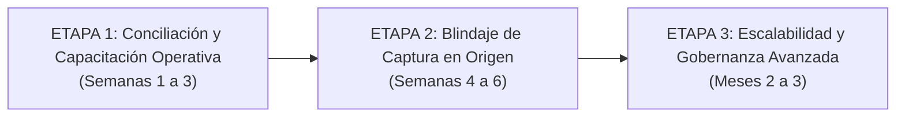

# PULSO Q | Consultoría en Sistemas de Información e Inteligencia Institucional
## Documento Técnico y Metodológico: Arquitectura, Diagnóstico y Auditoría del Sistema Estatal de Inteligencia Cultural

---

| Metadatos del Documento | Detalle Institucional y Técnico |
| :--- | :--- |
| **Proyecto:** | Diseño, Desarrollo e Implementación del Sistema de Información Cultural del Estado de Guanajuato |
| **Entidad Contratante / Usuaria:** | Secretaría de Cultura del Estado de Guanajuato |
| **Firma / Equipo Consultor:** | **PULSO Q** — Arquitectura de Software, Ciencia de Datos e Inteligencia de Negocios |
| **Versión del Documento:** | `v2.1 — Edición Ejecutiva y Memoria Técnica Auditada` |
| **Fecha de Emisión:** | 19 de Octubre de 2026 |
| **Repositorio / Entorno:** | Tablero Directivo Web (`index.html`), Aplicativo Operativo (`AppSheet`) y Base de Datos Relacional (`Google Sheets Cloud`) |

---

## 1. RESUMEN EJECUTIVO Y ALCANCE INSTITUCIONAL

El **Sistema Estatal de Inteligencia Cultural** (desarrollado bajo el marco metodológico de **PULSO Q**) constituye la plataforma tecnológica central de la **Secretaría de Cultura del Estado de Guanajuato** para estandarizar, capturar, conciliar y visualizar el desempeño programático, territorial y demográfico de la acción cultural pública en la entidad.

Previo a la intervención de **PULSO Q**, los registros de actividades artísticas y culturales operaban en instrumentos dispersos, sin validación de catálogos, con duplicidad entre conteos de asistencia masiva y participación formativa, y sin trazabilidad directa hacia el **Programa de Gobierno (PG)**, el **Programa Estatal de Cultura (PEC)** ni las **Zonas de Atención Prioritaria (ZAP)**.

### 1.1 Alcance de la Solución Implementada
La solución integral puesta en operación articula cuatro capas tecnológicas acopladas en tiempo real:
1. **Capa de Captura Operativa Estandarizada (AppSheet):** Formulario relacional guiado por reglas de negocio para las Direcciones Generales y unidades operativas.
2. **Capa de Persistencia Relacional y Gobernanza (Google Sheets Cloud):** Base de datos estructurada en **23 hojas activas** (**4 tablas transaccionales**, **1 vista maestra consolidada** y **18 catálogos maestros normalizados**).
3. **Capa de Inteligencia de Negocios y Seguimiento (Tablero Directivo Web):** Aplicación *Single-Page Application (SPA)* interactiva de 6 vistas analíticas que procesa en memoria las relaciones `1:N`, evalúa las **99 metas anuales programadas (6,535 actividades)** y audita en vivo la calidad de la captura.
4. **Capa de Reporteo Automatizado para Toma de Decisiones (Motor `PptxGenJS`):** Generador nativo en un clic de presentaciones ejecutivas en formato *Widescreen (16:9)* (`.pptx`), con extracción de gráficas en alta resolución y aplicación dinámica de los filtros seleccionados.

---

## 2. DIAGNÓSTICO DE FUENTES DE INFORMACIÓN Y BRECHAS OPERATIVAS (ENTREGABLE 1)

Como primera fase metodológica (**Entregable 1**), **PULSO Q** ejecutó un diagnóstico exhaustivo sobre las fuentes históricas de información, los flujos de reporte de las Direcciones Generales y la calidad de los datos capturados en el entorno productivo.

### 2.1 Hallazgos del Diagnóstico de Fuentes y Captura
A partir del análisis forense sobre el corte operativo real (**573 actividades**, **563 registros territoriales**, **1,033 registros demográficos** y **289 expedientes de evidencia**), se identificaron y documentaron las siguientes brechas estructurales:

| Dimensión Analizada | Problemática Histórica / Brecha Detectada | Impacto Institucional | Solución Arquitectónica PULSO Q |
| :--- | :--- | :--- | :--- |
| **1. Duplicidad entre Territorio y Demografía** | Las unidades operativas reportan el impacto por localidad en `Registro_Territorio` (**349,194 personas**) y el perfil por edad/género en `Registro_Poblacion` (**304,637 personas**), generando una brecha de **44,557 registros** y riesgo de doble conteo si se suman ambas fuentes. | Sobreestimación artificial de beneficiarios o discrepancias en informes oficiales de gobierno. | Implementación del **Conmutador Global Excluyente (`Territorial` vs. `Demográfico`)** en el Tablero y creación del **Módulo de Conciliación Operativa (Vista 6)** que exhibe por folio (`ID_Actividad`) cualquier variación (`diff = sT - sP`). |
| **2. Asistencias Masivas vs. Participación Activa** | Ausencia de distinción metodológica entre el público espectador de un evento masivo y los participantes de un proceso formativo o comunitario continuo. | Imposibilidad de medir la profundidad del impacto cultural y la reconstrucción del tejido social. | Separación estricta a nivel de campo en base de datos y tablero entre **`Cantidad_Participacion`** (involucramiento activo) y **`Cantidad_Acceso`** (público asistente). |
| **3. Heterogeneidad en Unidades de Medida de Metas** | El tabulador oficial de **99 metas anuales** combina metas medidas en *Actividades/Talleres/Eventos*, metas medidas en *Personas/Asistentes* y metas medidas en *Metros cuadrados* (infraestructura). | Sumar aritméticamente todas las metas distorsionaba el porcentaje real de avance institucional. | Clasificador semántico automático (`getUnitCategory`) que segrega `ACTIVIDADES` (**6,535 programadas**), `PERSONAS` y `METROS`, calculando tanto el **Avance Global Anual** como el **Avance sobre Metas en Operación**. |
| **4. Dispersión de Topónimos y Localidades** | Captura abierta de nombres de colonias y comunidades con variantes ortográficas (*"Zona Centro"*, *"Centro"*, *"Guanajuato Centro"*, valores vacíos). | Fragmentación del conteo de localidades atendidas y errores en la identificación de Zonas Prioritarias (ZAP). | Construcción del catálogo depurado **`Cat_Comunidades_Limpio`** (239 polígonos normalizados con banderas `ZAP_Nuevo_Comienzo` y `ZAP_SSyP`) y motor de normalización `normalizeCommunityName()`. |
| **5. Trazabilidad Documental Incompleta** | Actividades reportadas sin respaldo fotográfico o listas de asistencia localizables para auditoría. | Riesgo de observaciones por órganos fiscalizadores y contraloría interna. | Creación de la tabla relacional `Regitro_Evidencia` y de la **Vista 5 (Repositorio de Evidencias)**, que mide el **% de Cobertura Documental por Dirección General** y vincula cada expediente con Google Drive. |

---

## 3. ARQUITECTURA DEL MODELO RELACIONAL Y LOS 18 CATÁLOGOS MAESTROS (ENTREGABLE 2)

En cumplimiento del **Entregable 2**, se diseñó e implementó un **Modelo Relacional en Estrella / Copo de Nieve** que garantiza la captura normalizada (3FN) en las tablas operativas y la integridad semántica mediante **18 catálogos maestros**.

### 3.1 Diagrama Entidad-Relación (ERD) del Sistema

```mermaid
erDiagram
    Cat_Alineacion ||--o{ Registro_Actividades : "ID_Alineacion = Clave_Proceso (FK)"
    Registro_Actividades ||--o{ Registro_Territorio : "ID_Actividad (1:N)"
    Registro_Actividades ||--o{ Registro_Poblacion : "ID_Actividad (1:N)"
    Registro_Actividades ||--o{ Regitro_Evidencia : "ID_Actividad (1:N)"

    Cat_Municipio ||--o{ Registro_Territorio : "Municipio"
    Cat_Comunidades_Limpio ||--o{ Registro_Territorio : "ID_Comunidad = Comunidad"
    Cat_Tipo_Asentamiento ||--o{ Registro_Territorio : "Tipo_Asentamiento"

    Cat_Disciplina ||--o{ Registro_Actividades : "Disciplina / Subdisciplina"
    Cat_Actividades ||--o{ Registro_Actividades : "Actividad / Atributos"
    Cat_Tipo_Actividad ||--o{ Registro_Actividades : "Tipo_Actividad"
    Cat_Recintos ||--o{ Registro_Actividades : "Nombre_Espacio"
    Cat_Tipo_Espacio ||--o{ Registro_Actividades : "Tipo_Espacio"
    Cat_Agentes_Culturales ||--o{ Registro_Actividades : "Tipo_Agente_Apoyado"
    Cat_Indicadores ||--o{ Registro_Actividades : "Indicador_Oficial"
    Cat_Enfoque ||--o{ Registro_Actividades : "Enfoque_Actividad"
    Cat_Formato ||--o{ Registro_Actividades : "Formato"
    Cat_Costo ||--o{ Registro_Actividades : "Costo"

    Cat_Grupo_Etario ||--o{ Registro_Poblacion : "Grupo_Etario"
    Cat_Genero ||--o{ Registro_Poblacion : "Genero"
    Cat_Grupo_Prioritario ||--o{ Registro_Poblacion : "Grupo_Prioritario"
```



### 3.2 Especificación de las Entidades Transaccionales Principales

1. **`Registro_Actividades` (Entidad Padre — 72 atributos):**
   - **Llave Primaria (PK):** `ID_Actividad` (Formato alfanumérico secuencial `ACT00001`..`ACT99999`) acompañado de un `Folio` único de transacción (`SC-YYMMDD-HHMMSS`).
   - **Llave Foránea Estratégica (FK):** `Clave_Proceso` (apunta a `Cat_Alineacion.ID_Alineacion`), de la cual hereda automáticamente `Clave_Proceso_Txt` (`PB3572`, `QC4102`, etc.), `Area`, `Direccion`, `Meta`, `Nombre_Meta`, `Unidad_Medida`, `Meta_Anual`, `Eje_PG`, `Objetivo_PG`, `Estrategia_PG`, `Acciones_PG`, `Eje_Tranversal_PEC`, `Linea_PEC`, `Estrategia_PEC`, `Acciones_PEC` y `Metas_PEC`.
   - **Atributos Operativos y Financieros:** `Enfoque_Actividad` (*Cultural* / *Artística*), `Nombre_Actividad`, `Descripcion_Breve`, `Fecha_Inicio`, `Fecha_Fin`, `Total_Sesiones`, `Disciplina`, `Subdisciplina`, `Tipo_Actividad`, `Formato`, `Tipo_Espacio`, `Nombre_Espacio`, `Costo`, `Monto_Ingreso`, `Monto_Total_Contratado` y `Usuario_Registra`.

2. **`Registro_Territorio` (Entidad Hija `1:N` — 16 atributos):**
   - **Llave Primaria (PK):** `ID_Territorio` (Hash hexadecimal de 8 caracteres generado por AppSheet, ej. `4db1e6e8`).
   - **Llave Foránea (FK):** `ID_Actividad` $\rightarrow$ `Registro_Actividades.ID_Actividad`.
   - **Atributos Geográficos y de Impacto:** `Municipio`, `Tipo_Asentamiento` (*Urbano*, *Periurbano*, *Rural*), `Comunidad` (FK a `Cat_Comunidades_Limpio`), `Nombre_Comunidad_Final`, `ZAP_Nuevo_Comienzo` (`Si`/`No`), `ZAP_SSyP` (`Si`/`No`), `Cantidad_Participacion`, `Cantidad_Acceso` y `Cantidad` (Total territorial de la sede).

3. **`Registro_Poblacion` (Entidad Hija `1:N` — 8 atributos):**
   - **Llave Primaria (PK):** `ID_Poblacion` (Hash hexadecimal de 8 caracteres, ej. `c674760c`).
   - **Llave Foránea (FK):** `ID_Actividad` $\rightarrow$ `Registro_Actividades.ID_Actividad`.
   - **Atributos Demográficos:** `Grupo_Etario`, `Genero`, `Grupo_Prioritario`, `Cantidad_Participacion`, `Cantidad_Acceso` y `Cantidad_Poblacion`.

4. **`Regitro_Evidencia` (Entidad Hija `1:N` — 5 atributos):**
   - **Llave Primaria (PK):** `ID_Evidencia` (Hash hexadecimal de 8 caracteres, ej. `ff739d20`).
   - **Llave Foránea (FK):** `ID_Actividad` $\rightarrow$ `Registro_Actividades.ID_Actividad`.
   - **Atributos Documentales:** `Archivo_Evidencia` (ruta a Google Drive), `Tipo_Evidencia` (*Fotografía*, *PDF*, *Carpeta/ZIP*, *Presentación*) y `Descripcion`.

### 3.3 Diccionario de los 18 Catálogos Maestros del Sistema

| # | Catálogo Maestro | Filas Activas | Llave / Estructura de Columnas | Función de Control y Gobernanza |
| :-: | :--- | :-: | :--- | :--- |
| **01** | `Cat_Alineacion` | 99 | `ID_Alineacion`, `Clave_Proceso`, `Area`, `Direccion`, `Meta`, `Nombre_Meta`, `Unidad_Medida`, `Meta_Anual`, `Promesa_NC`, `Eje_PG`..`Metas_PEC` | Rectoría programática: vincula las **99 metas anuales** y **34 procesos presupuestales** con el Programa de Gobierno y el PEC. |
| **02** | `Cat_Disciplina` | 82 | `ID_Disciplina`, `Disciplina`, `Subdisciplina`, `Tipo_Actividad`, `Proceso_Institucional` | Selección jerárquica dependiente para evitar combinaciones inválidas de disciplinas y subdisciplinas. |
| **03** | `Cat_Actividades` | 84 | `ID_Actividad`, `Actividad`, `Tipo_Actividad`, `Tipo_Proceso_Formacion`..`Tipo_Vinculacion` | Define el comportamiento condicional del formulario según la naturaleza de la actividad. |
| **04** | `Cat_Tipo_Actividad` | 87 | `Tipo_Actividad` | Vocabulario controlado de formatos (*Taller*, *Concierto*, *Exposición*, *Conversatorio*, etc.). |
| **05** | `Cat_Recintos` | 27 | `ID_Recinto`, `Nombre_Recinto`, `Tipo_Espacio` | Padrón oficial de museos, teatros, bibliotecas y centros culturales estatales. |
| **06** | `Cat_Tipo_Espacio` | 7 | `Tipo_Espacio` | Clasifica la titularidad del inmueble (*A cargo de la Secretaría*, *Espacio Público*, *Escolar*, etc.). |
| **07** | `Cat_Agentes_Culturales` | 28 | `ID_Agente`, `Categoria_Principal`, `Tipo_Agente` | Tipología de agentes del sector cultural (*Creación*, *Gestión*, *Portadores de patrimonio*). |
| **08** | `Cat_Indicadores` | 9 | `ID_Indicador`, `Clave_Indicador`, `Nombre_Indicador`, `Unidad_Medida`, `Activo`, `Instrumento` | Catálogo de indicadores estratégicos de nivel superior (`I00802`, etc.). |
| **09** | `Cat_Enfoque` | 2 | `ID_Enfoque`, `Enfoque_Actividad` | Clasificación sustantiva: `Artística` vs. `Cultural`. |
| **10** | `Cat_Formato` | 3 | `Formato` | Modalidad de entrega: `Presencial`, `Virtual`, `Híbrido`. |
| **11** | `Cat_Costo` | 2 | `Costo` | Condición de gratuidad: `Sin costo` vs. `Con cuota de recuperación`. |
| **12** | `Cat_Grupo_Etario` | 7 | `Grupo_Etario` | Segmentación por ciclo de vida (*Primera Infancia 0-5* hasta *Adultos Mayores 60+*). |
| **13** | `Cat_Genero` | 5 | `Genero` | *Mujer*, *Hombre*, *No binario*, *Dato global*, *No se cuenta con el dato*. |
| **14** | `Cat_Grupo_Prioritario` | 9 | `Grupo_Prioritario` | Poblaciones de atención prioritaria (*NNA*, *Personas con Discapacidad*, *Pueblos Indígenas*, etc.). |
| **15** | `Cat_Tipo_Asentamiento` | 3 | `Tipo_Asentamiento` | Caracterización geográfica: `Urbano`, `Periurbano`, `Rural`. |
| **16** | `Cat_Municipio` | 47 | `Municipio` | Los **46 municipios** constitucionales de Guanajuato + `Ciudad de mexico` (sede nacional). |
| **17** | `Cat_Comunidades` | 171 | `ID_Comunidad`, `Municipio`, `Comunidad`, `Zap_Nuevo_Comienzo`, `ZAP_SSyP` | Catálogo base de localidades y polígonos prioritarios. |
| **18** | `Cat_Comunidades_Limpio` | 239 | `ID_Comunidad`, `Municipio`, `Comunidad`, `Zap_Nuevo_Comienzo`, `ZAP_NC_SI/NO`, `ZAP_SSyP` | Catálogo maestro depurado por **PULSO Q** con banderas dicotómicas (`Si`/`No`) para cruce inmediato de ZAP. |

---

## 4. MAPA DEL FLUJO DE INFORMACIÓN Y PROCESO OPERATIVO (ENTREGABLE 4)

El siguiente diagrama arquitectónico (**Entregable 4**) documenta el ciclo de vida completo del dato, desde su captura en campo por las unidades operativas hasta la descarga de una presentación ejecutiva para acuerdo directivo:

```mermaid
flowchart TB
    subgraph CAPA1["1. CAPTURA OPERATIVA EN CAMPO (AppSheet)"]
        U["Enlace / Capturista de Dirección General<br/>(@guanajuato.gob.mx)"]
        F1["Paso 1: Alta de Ficha de Actividad<br/>(Selecciona Meta de Cat_Alineacion)"]
        F2["Paso 2: Registro Territorial (1:N)<br/>(Municipio, Comunidad y Polígono ZAP)"]
        F3["Paso 3: Desglose Demográfico (1:N)<br/>(Grupo Etario, Género, Grupo Prioritario)"]
        F4["Paso 4: Carga de Evidencia (1:N)<br/>(Fotografías, Listas PDF, Carpetas en Drive)"]
        U --> F1 --> F2 --> F3 --> F4
    end

    subgraph CAPA2["2. PERSISTENCIA RELACIONAL Y ALMACENAMIENTO (Google Cloud)"]
        GS[("Google Sheets Master DB<br/>(23 Hojas: 4 Tablas + 18 Catálogos)")]
        GD[("Repositorio Google Drive<br/>(Regitro_Evidencia_Files_)")]
        F1 & F2 & F3 -->|Escritura Transaccional| GS
        F4 -->|Metadatos y Ruta| GS
        F4 -->|Almacenamiento Binario| GD
    end

    subgraph CAPA3["3. MOTOR ANALÍTICO EN MEMORIA (Tablero Directivo SPA)"]
        ETL["Sincronización Paralela CSV (gviz/tq)<br/>Promise.all() • 5 Tablas • Timeout 9s + Retry"]
        PARSE["PapaParse Client ETL + Normalización<br/>(Fechas ISO, Topónimos, Números, Coordenadas)"]
        STATE["Motor Reactivo de Filtrado Multidimensional<br/>(7 Filtros Globales + Conmutador Poblacional)"]
        VIEWS["6 Vistas Directivas + 11 Gráficas Chart.js<br/>+ Mapa Geoespacial Leaflet (46 Municipios)"]
        GS -->|Lectura en Vivo (no-store)| ETL --> PARSE --> STATE --> VIEWS
        GD -.->|Consulta de Expediente| VIEWS
    end

    subgraph CAPA4["4. REPORTEO EJECUTIVO AUTOMATIZADO (Motor PptxGenJS)"]
        BTN["Botón 'Exportar Presentación Ejecutiva'<br/>(#btn-export-pptx)"]
        RENDER["Extracción de Escudo Oficial + Gráficas HD<br/>(getChartHighResBase64 • 1280px Canvas)"]
        DECK["Generación de Mazo Widescreen 16:9 (6 Láminas)<br/>Presentacion_Ejecutiva_Cultura_GTO_YYYYMMDD.pptx"]
        VIEWS --> BTN --> RENDER --> DECK
    end
```

### 4.1 Descripción Paso a Paso del Proceso Operativo
1. **Captura Guiada en AppSheet:** El enlace operativo selecciona su proceso y meta institucional; AppSheet autocompleta por referencia (`Dereference`) toda la cadena de alineación del Programa de Gobierno y del PEC, impidiendo errores de captura manual. Posteriormente agrega las sedes (`Registro_Territorio`), los segmentos de población (`Registro_Poblacion`) y sube los archivos probatorios (`Regitro_Evidencia`).
2. **Sincronización en Tiempo Real (`fetchSheetCSV`):** Al abrir el Tablero Directivo, el navegador lanza 5 peticiones asíncronas concurrentes (`Promise.all`) hacia el endpoint `gviz/tq?tqx=out:csv` de Google Sheets, procesando en menos de 1.5 segundos las tablas `Registro_Actividades`, `Registro_Territorio`, `Registro_Poblacion`, `Regitro_Evidencia` y `Cat_Alineacion`.
3. **Procesamiento y Cruce Relacional en Cliente (`applyFilters`):** Cada cambio en cualquiera de los **7 filtros globales** (Periodo, Municipio, Dirección General, Disciplina, Programa de Gobierno, Enfoque o Zona Prioritaria) o en el **Conmutador Poblacional (`Territorial` / `Demográfico`)** recalcula en milisegundos el conjunto `filteredActIds` y actualiza las 6 vistas:
   - *Vista 1:* Visión General del Ecosistema Cultural.
   - *Vista 2:* Matriz Estratégica y Seguimiento de las 99 Metas.
   - *Vista 3:* Cobertura Territorial y Atención en Zonas Prioritarias (ZAP).
   - *Vista 4:* Perfil de Población, Grupos Prioritarios y Expediente por Actividad.
   - *Vista 5:* Repositorio y Cumplimiento de Evidencia Documental.
   - *Vista 6:* Conciliación Operativa (Auditoría de cifras Territorial vs. Demográfico con descarga CSV).
4. **Generación de Presentación Ejecutiva (`.pptx`):** Con un solo clic en **"Exportar Presentación Ejecutiva"**, el sistema empaqueta el estado exacto de los filtros activos, los indicadores clave y las gráficas en alta resolución dentro de una presentación nativa de PowerPoint lista para sesiones de gabinete o acuerdos directivos.

---

## 5. MEMORIA DE AUDITORÍA TÉCNICA Y MEJORAS IMPLEMENTADAS

Como parte del aseguramiento de calidad (**QA & Software Architecture Audit**), **PULSO Q** realizó la verificación integral del código y de la base de datos en vivo, dejando implementadas en producción las siguientes mejoras críticas:

### 5.1 Verificación de Integridad Referencial al 100% (`0` Huérfanos)
Se ejecutó una auditoría automatizada de llaves primarias y foráneas (`ID_Actividad`) sobre la totalidad de los registros activos en la nube:
- **`Registro_Actividades`:** `573` actividades únicas válidas.
- **`Registro_Territorio`:** `563` registros hijos $\rightarrow$ **`0` registros huérfanos** (100% de integridad referencial hacia su actividad padre).
- **`Registro_Poblacion`:** `1,033` registros hijos $\rightarrow$ **`0` registros huérfanos** (100% de integridad referencial).
- **`Regitro_Evidencia`:** `289` archivos documentales $\rightarrow$ **`0` registros huérfanos** (100% de integridad referencial).

### 5.2 Cobertura Geoespacial Completa de los 46 Municipios (`GTO_COORDS`)
- **Hallazgo corregido:** La versión preliminar del tablero contenía únicamente 19 coordenadas municipales en `GTO_COORDS`, lo que dejaba fuera de la visualización cartográfica a 8 municipios que ya registraban actividad en la base de datos (*Abasolo, Apaseo el Grande, Cuerámaro, Doctor Mora, Jerécuaro, San Felipe, Valle de Santiago y Villagrán*).
- **Mejora implementada:** Se integró en [`index.html`](file:///d:/Proyectos/dashboard-planeacion/index.html) el diccionario completo de coordenadas geográficas (`[latitud, longitud]`) para las **46 cabeceras municipales del Estado de Guanajuato**, junto con el motor de resolución normalizada `getMunicipioCoords(mun)` (tolerante a mayúsculas, acentos y variantes como `Pueblo Nuevo` / `Pueblonuevo`).
- **Resultado:** Coincidencia del **100%** entre el indicador numérico de cobertura estatal (`25/46` municipios activos, `54.3%`) y los marcadores interactivos renderizados en el mapa de Leaflet.

### 5.3 Implementación del Motor de Exportación Ejecutiva Widescreen (`PptxGenJS`)
- Se incorporó la librería `PptxGenJS v3.12.0` y el módulo `exportExecutivePPTX()` con soporte para **renderizado fuera de pantalla (`getChartHighResBase64`)**, el cual redimensiona temporalmente los lienzos `<canvas>` de las pestañas ocultas a `1280px` sobre fondo blanco sólido antes de extraer su imagen en alta definición.
- El archivo `.pptx` descargado incluye **6 láminas ejecutivas en proporción 16:9 (`LAYOUT_WIDE`)**:
  1. **Portada Institucional:** Escudo oficial de la Secretaría de Cultura, fecha de corte y tabla de parámetros/filtros activos.
  2. **Visión General:** 4 tarjetas KPI vectoriales + Evolución Mensual + Top Disciplinas + Distribución por Programa de Gobierno.
  3. **Matriz Estratégica:** KPIs de avance global y en operación + Gráficas de Ejes/Enfoque + Tabla vectorial del Top de Metas Institucionales.
  4. **Cobertura Territorial y ZAP:** KPIs territoriales + Gráfica apilada de ZAP por Municipio + Top Municipios con mayor programación.
  5. **Perfil Demográfico e Inclusión:** KPIs de Participación vs. Acceso + Gráficas de Grupo Etario y Grupos Prioritarios.
  6. **Respaldo Documental y Conciliación:** Cumplimiento de evidencias por Dirección General + Distribución por tipo de archivo + Resumen ejecutivo de conciliación.

### 5.4 Optimización de Activos Estáticos y Limpieza de Consola
- Se corrigió la referencia de carga del arte postal en el menú lateral (`src="assets/interfaz/postal.jpg"` en `#custom-postal-img`), eliminando errores `404 Not Found` en consola y garantizando una carga limpia del DOM.

---

## 6. HOJA DE RUTA PARA DESPLIEGUE Y CAPACITACIÓN CON UNIDADES OPERATIVAS

Para consolidar la adopción institucional del **Sistema Estatal de Inteligencia Cultural** en todas las Direcciones Generales y unidades adscritas de la Secretaría de Cultura de Guanajuato, **PULSO Q** establece la siguiente hoja de ruta en tres etapas:



### Etapa 1: Talleres de Capacitación y Cierre de Brechas de Conciliación (Semanas 1–3)
1. **Sesiones de Capacitación por Dirección General:**
   - Entrenamiento práctico a los enlaces de captura en el uso de **AppSheet** (diferenciación entre *Participación Activa* y *Acceso*, selección correcta de polígonos *ZAP* y nomenclatura de evidencias).
   - Capacitación a titulares de Dirección General y equipo de Planeación en el uso del **Tablero Directivo** y la generación de reportes con el nuevo **Exportador de Presentaciones Ejecutivas (`.pptx`)**.
2. **Jornada de Conciliación Operativa (Uso de la Vista 6):**
   - Descargar el reporte `Conciliacion_Operativa_Cultura_GTO.csv` desde la pestaña **Conciliación** del tablero y distribuirlo a los enlaces responsables (`Usuario_Registra`) para homologar las actividades que presentan diferencia entre su cifra territorial y demográfica, así como adjuntar las evidencias pendientes.

### Etapa 2: Reglas de Validación en Origen y Enlaces Directos a Drive (Semanas 4–6)
1. **Candado de Cuadre en AppSheet (`Valid_If`):**
   - Configurar una alerta de validación en el flujo de cierre de actividad en AppSheet para advertir al usuario cuando $\sum \text{Cantidad (Territorio)} \neq \sum \text{Cantidad\_Poblacion (Demográfico)}$, asegurando que toda nueva actividad nazca conciliada desde el origen.
2. **Activación de Seguimiento para Metas de Infraestructura (`METROS`):**
   - Habilitar en el formulario de captura el campo numérico específico para reportar el avance de las metas cuya unidad de medida en `Cat_Alineacion` corresponde a *Metros cuadrados intervenidos/rehabilitados*.
3. **Permisos Homologados de la Carpeta de Evidencias en Google Drive:**
   - Compartir en modo lectura institucional la carpeta raíz `Regitro_Evidencia_Files_` con las cuentas `@guanajuato.gob.mx` del cuerpo directivo para garantizar la apertura inmediata de cualquier PDF o fotografía desde el modal de expediente.

### Etapa 3: Evolución Tecnológica hacia Arquitectura Empresarial (Meses 2–3)
1. **Capa Intermedia de Seguridad (Proxy BFF / Google Apps Script o Supabase):**
   - A medida que el padrón supere los 5,000 registros anuales, desacoplar la lectura directa del CSV público mediante un servicio autenticado con control de acceso basado en roles (**RBAC por Dirección General**) e inicio de sesión institucional.
2. **Caché Local Resiliente (`IndexedDB`):**
   - Incorporar almacenamiento local instantáneo (*Stale-While-Revalidate*) en el navegador para que el tablero cargue en `< 200 ms` incluso en condiciones de conectividad limitada durante giras de trabajo en municipios.

---
*Documento elaborado y certificado técnicamente por **PULSO Q** para la **Secretaría de Cultura del Estado de Guanajuato**.*
